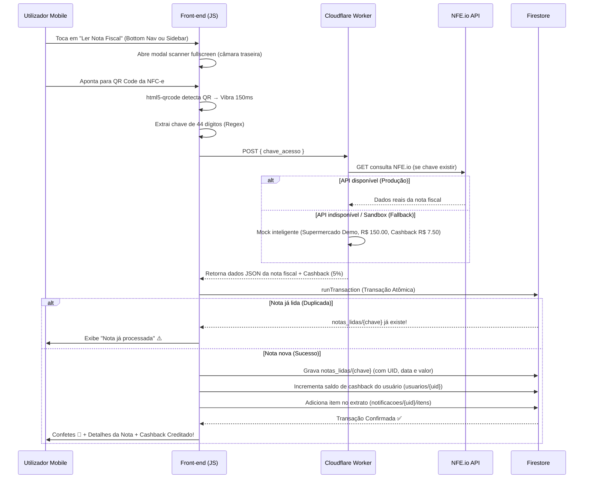

# +PROMO — Manual do Desenvolvedor: Scanner de NFC-e (Cashback)

Este manual documenta o fluxo completo, a arquitetura e os passos de configuração e deploy para a funcionalidade de **Leitura de Nota Fiscal (NFC-e) para Cashback** no projeto **+PROMO**.

---

## 📋 Índice
1. [Visão Geral da Arquitetura](#-visão-geral-da-arquitetura)
2. [NFE.io — Configuração da API](#1-nfeio-—-configuração-da-api)
3. [Cloudflare Workers — Deploy e Segredos](#2-cloudflare-workers-—-deploy-e-segredos)
4. [Firebase — Regras de Segurança e Banco de Dados](#3-firebase-—-regras-de-segurança-e-banco-de-dados)
5. [Ambiente de Testes — Como Validar Localmente](#4-ambiente-de-testes-—-como-validar-localmente)
6. [Checklist de Produção (Go-Live)](#5-checklist-de-produção-go-live)

---

## 🏗️ Visão Geral da Arquitetura

O fluxo foi concebido para ser **exclusivamente mobile**, ágil e extremamente seguro contra fraudes de duplicidade (leitura múltipla da mesma nota).



---

## 1. NFE.io — Configuração da API

A NFE.io é utilizada para consultar a chave de 44 dígitos da SEFAZ de forma simplificada e retornar os dados estruturados da nota fiscal (valor total, estabelecimento, CNPJ, itens).

### Passo a Passo:
1. **Cadastro**: Crie uma conta no portal do desenvolvedor da [NFE.io](https://nfe.io/).
2. **Ambiente Sandbox**:
   - Utilize o ambiente de Sandbox/Teste gratuito para obter as credenciais de desenvolvimento.
3. **Obter API Key**:
   - No painel da NFE.io, acesse **Configurações da Conta** ou **Chaves de API**.
   - Copie a sua chave privada.
4. **ID da Empresa**:
   - O Worker utiliza a rota `/companies/default/` que mapeia para a empresa configurada como padrão na sua conta. Caso queira fixar um ID específico, altere o endpoint no arquivo [worker.js](file:///c:/Users/lipwc/Downloads/+%20Promo/workers/nfe-scanner/worker.js#L104) para `/companies/{company_id}/`.

---

## 2. Cloudflare Workers — Deploy e Segredos

O back-end do scanner roda em uma arquitetura serverless de altíssima velocidade e baixíssima latência nas bordas da Cloudflare.

### Arquivos Criados:
- **Configurações**: [wrangler.toml](file:///c:/Users/lipwc/Downloads/+%20Promo/workers/nfe-scanner/wrangler.toml)
- **Código-fonte**: [worker.js](file:///c:/Users/lipwc/Downloads/+%20Promo/workers/nfe-scanner/worker.js)

### Deploy e Comandos:

Certifique-se de estar na pasta do worker antes de executar os comandos:
```powershell
cd "c:\Users\lipwc\Downloads\+ Promo\workers\nfe-scanner"
```

1. **Autenticar no Wrangler**:
   ```bash
   npx wrangler login
   ```
2. **Testar Localmente**:
   ```bash
   npx wrangler dev
   ```
3. **Adicionar API Key (Segredo de Produção)**:
   Adicione a API Key da NFE.io como variável secreta encriptada no Worker:
   ```bash
   npx wrangler secret put NFE_API_KEY
   # Insira a chave da NFE.io quando solicitado
   ```
4. **Deploy para Produção**:
   ```bash
   npx wrangler deploy
   ```
   *Nota: O deploy criará o endpoint público `https://nfe-scanner.sacmaispromo.workers.dev`.*

---

## 3. Firebase — Regras de Segurança e Banco de Dados

Implementamos regras estritas de segurança em [firestore.rules](file:///c:/Users/lipwc/Downloads/+%20Promo/firestore.rules) para blindar o saldo de cashback dos usuários contra manipulações diretas e injetar o anti-fraude atômico.

### O que mudou nas regras:
- **`notas_lidas/{chave}`**: Apenas usuários autenticados podem ler ou gravar, mas **nunca** atualizar ou deletar (preservando o histórico anti-fraude para sempre).
- **`usuarios/{userId}`**: Adicionamos o helper `isValidCashbackIncrement()` que permite que o front-end incremente o saldo de `cashback` do usuário diretamente no Firestore **somente se** for um incremento estritamente positivo e limitado a no máximo **R$ 500,00** por nota (para evitar manipulações de valores astronômicos).

### Como fazer o deploy das regras:
No terminal principal do projeto:
```powershell
cd "c:\Users\lipwc\Downloads\+ Promo"
npx firebase deploy --only firestore:rules
```

---

## 4. Ambiente de Testes — Como Validar Localmente

O Worker foi projetado com um **Mock Inteligente**. Se ele não possuir a chave de API (`NFE_API_KEY`) configurada no ambiente local, ele atuará de forma robusta retornando dados simulados consistentes contendo:
- **Estabelecimento**: `Supermercado Demo`
- **Valor da Nota**: `R$ 150,00`
- **Cashback Gerado**: `R$ 7,50 (5%)`
- **Chave de Acesso**: A mesma chave de 44 dígitos que você leu!

### Como gerar um QR Code de teste válido:
1. Acesse um gerador de QR Code online (como o [QR Code Generator](https://br.qr-code-generator.com/)).
2. Cole a URL padrão da SEFAZ contendo uma chave fictícia de 44 dígitos numéricos:
   `https://www.sefaz.rs.gov.br/ASP/AAE_ROOT/NFE/SAT-WEB-NFE-NFC_QRCODE_1.aspx?p=43260592702064000189650010002874131589408643`
3. Aponte a câmara do telemóvel para o QR Code gerado no modal da aplicação:
   - **Primeira leitura**: O sistema vibrará, chamará o Worker, fará a transação no Firestore, mostrará a chuva de confetes 🎉 e creditará os R$ 7,50 na carteira do usuário.
   - **Segunda leitura (com a mesma chave)**: O sistema bloqueará a leitura apontando instantaneamente a tela de erro: **"Nota já processada"**!

---

## 5. Checklist de Produção (Go-Live)

Antes de abrir a funcionalidade para todos os usuários do **+PROMO**, garanta que todos os itens abaixo estão validados:

- [ ] **Deploy do Worker**: Worker publicado com sucesso e URL verificada em [main.js](file:///c:/Users/lipwc/Downloads/+%20Promo/js/dashboard/main.js#L2284).
- [ ] **Secret no Worker**: `NFE_API_KEY` cadastrada no Cloudflare via `wrangler secret put`.
- [ ] **Regras do Firestore**: Regras publicadas via `firebase deploy --only firestore:rules`.
- [ ] **CORS Restrito**: No arquivo [worker.js](file:///c:/Users/lipwc/Downloads/+%20Promo/workers/nfe-scanner/worker.js#L37), substitua o wildcard `'Access-Control-Allow-Origin': '*'` pela URL oficial do domínio em produção (ex: `'https://sacmaispromo.com.br'`) para evitar chamadas de terceiros.
- [ ] **Domínio Customizado**: Adicionar rota customizada no Cloudflare Dashboard caso prefira expor a API sob o seu próprio domínio (ex: `api.sacmaispromo.com.br/nfe-scanner`).

---
✨ **+PROMO** — Transformando notas fiscais em cashback real com segurança, robustez e performance mobile!
